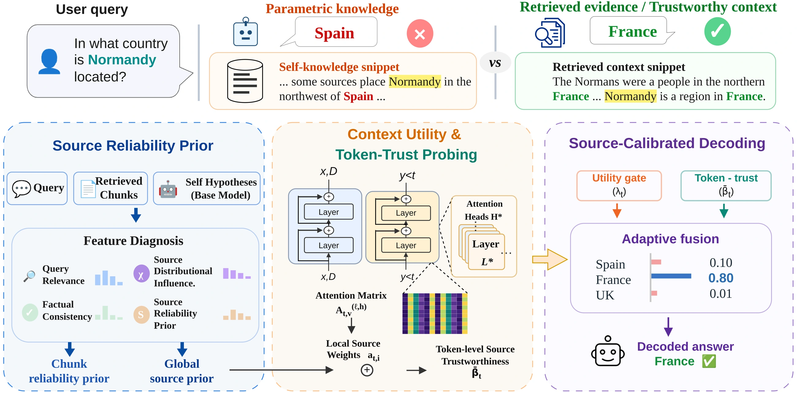

# S-CAD

## Source-Calibrated Adaptive Decoding for Trustworthy Retrieval-Augmented Generation

**Yalong Guo, Yangsen Zhang\*, Jing Kang, and Siwei Wang**  
Institute of Intelligent Information Processing, Beijing Information Science and Technology University  
\* Corresponding author

 [**BibTeX**](CITATION.bib) 

S-CAD connects source reliability with token-level decoding to improve retrieval-augmented generation under noisy and conflicting evidence.

### Overview

Retrieved passages can be noisy, outdated, or mutually inconsistent. Amplifying all retrieved context can reinforce unreliable evidence and combine incompatible facts. S-CAD connects source-level reliability assessment with token-level probability control. It estimates a reliability prior for each source, traces which sources contribute during generation through attention attribution, and calibrates a decoding gate to balance parametric knowledge with retrieved evidence.

<details>
<summary>中文简介</summary>

S-CAD 将来源可靠性与词元级解码相结合，改善噪声与冲突证据下的检索增强生成。该方法为检索来源估计可靠性先验，再通过注意力归因跟踪生成过程中实际使用的来源，并校准解码门控，动态平衡参数化知识与检索证据。

</details>

### Method



*Figure 2 from the paper.*

1. **Source reliability prior.** Combine query relevance, factual consistency, and the distributional influence of each source.
2. **Attention-grounded trust.** Track source utilization at each token and combine local reliability with the global prior.
3. **Source-calibrated gate.** Combine token trust with a JSD-driven gate to interpolate context-free and context-conditioned distributions.

### Selected results

The paper evaluates FaithEval, RealtimeQA, SQuAD, and MuSiQue with three instruction-tuned backbones. In mixed retrieval, S-CAD has the highest accuracy among the compared methods in all 12 backbone–dataset combinations in Table 1.

| Backbone | Origin average ACC (%) | S-CAD average ACC (%) | Reported improvement (pp) |
|---|---:|---:|---:|
| Llama3.1-8B-Inst | 74.35 | 85.27 | +10.92 |
| Qwen2.5-7B-Inst | 74.81 | 85.24 | +10.43 |
| Mistral-7B-Inst | 69.61 | 83.95 | +14.35 |

On RealtimeQA, Qwen2.5-7B-Inst reaches **91.15% ACC**, improving by **12.45 percentage points** over Origin and **7.05 points** over FaithfulRAG. Values follow Table 1. Improvements use the source precision before rounding the average.

Golden retrieval has mixed ACC/F1 tradeoffs. The gains above do not imply the highest score for every metric or condition.

### Citation

```bibtex
@misc{guo2026scad,
  title = {{S-CAD}: Source-Calibrated Adaptive Decoding for Trustworthy Retrieval-Augmented Generation},
  author = {Guo, Yalong and Zhang, Yangsen and Kang, Jing and Wang, Siwei},
  year = {2026}
}
```

### Contact

- Yalong Guo: [yalonguo@163.com](mailto:yalonguo@163.com)
